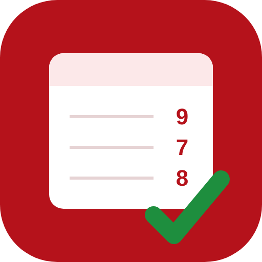
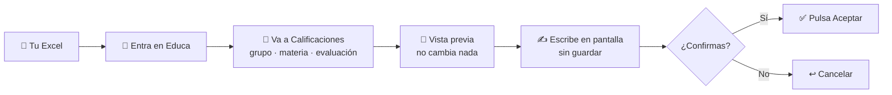

<div align="center">



# Educa Navarra · notas con IA

**Pásale tu Excel de notas a Claude y él las mete en Educa por ti.**
Tú revisas y decides cuándo se guardan.

[](https://www.npmjs.com/package/educa-navarra-mcp)
[](LICENSE)
[](https://github.com/vTanco/educa-navarra-mcp/actions/workflows/ci.yml)


[**⬇️ Descargar para Claude Desktop**](https://github.com/vTanco/educa-navarra-mcp/releases/latest/download/educa-navarra-mcp.mcpb) · [Cómo se usa](#-cómo-se-usa) · [Prepara tus Excel](docs/BUENAS-PRACTICAS.md) · [Preguntas frecuentes](#-preguntas-frecuentes) · [Aviso legal](AVISO-LEGAL.md)

</div>

> [!IMPORTANT]
> **Herramienta no oficial.** No está hecha ni respaldada por el Gobierno de Navarra ni por el Departamento de Educación. Usas tu propia cuenta de Educa y eres responsable de las notas que guardes. Lee el [aviso legal](AVISO-LEGAL.md) antes de usarla.

---

## ✨ Qué hace

| | |
|---|---|
| 📄 **Lee tu fichero** | Excel (`.xlsx`) o CSV, con las columnas que tengas. Basta con *alumno* y *nota*. |
| 🔎 **Cruza nombres** | Empareja tu lista con la de Educa aunque cambien tildes, mayúsculas o el orden de nombre y apellidos. |
| 👀 **Te enseña una vista previa** | Nota actual, nota nueva y avisos (alumnos que faltan, nombres dudosos, notas fuera de rango) **antes de tocar nada**. |
| ✍️ **Escribe en pantalla** | Rellena las notas en la ventana de Educa, sin guardar, para que las revises con tus ojos. |
| ✅ **Guarda solo si tú lo dices** | Pulsa *Aceptar* únicamente cuando lo confirmas en el chat. |
| 🔒 **Nunca cierra ni firma** | Se niega a pulsar botones de cerrar, firmar, bloquear, borrar o publicar una evaluación. |

Pensado para **ESO** (IN · SU · BI · NT · SB), **Bachillerato** (nota sobre 10) y **FP de Grado Medio y Superior**, según la LOMLOE.

## 🚀 Instalación

### Opción A · Claude Desktop (recomendada, sin saber informática)

1. Instala [Claude Desktop](https://claude.ai/download) si no lo tienes.
2. **[Descarga `educa-navarra-mcp.mcpb`](https://github.com/vTanco/educa-navarra-mcp/releases/latest/download/educa-navarra-mcp.mcpb)**.
3. Haz **doble clic** en el fichero descargado. Claude Desktop se abre y te pregunta si quieres instalarlo: pulsa **Instalar**.
4. Te pedirá tu **usuario y contraseña de Educa**. Son **opcionales**: si los pones, Claude entra solo en Educa; si los dejas vacíos, entras tú en la ventana que se abre. La contraseña se guarda cifrada en tu ordenador.
5. Te preguntará también por tu **carpeta de notas**. Deja la que sale (*Documentos/Notas Educa*) y créala si no la tienes: ahí guardarás tus Excel.

Y ya está. No hace falta instalar nada más: usa el **Google Chrome** o **Microsoft Edge** que ya tienes. Si no tienes ninguno, descarga un navegador la primera vez (tarda un par de minutos).

> [!TIP]
> Si el doble clic no funciona: en Claude Desktop ve a **Ajustes → Extensiones → Instalar extensión…** y elige el fichero.

### Opción B · Claude Code (una línea)

```bash
claude mcp add educa -- npx -y educa-navarra-mcp
```

### Opción C · Otras aplicaciones de IA (Cursor, VS Code, Windsurf, LM Studio…)

Necesitas [Node.js 20 o superior](https://nodejs.org). Añade esto a la configuración de servidores MCP de tu aplicación:

```json
{
  "mcpServers": {
    "educa": {
      "command": "npx",
      "args": ["-y", "educa-navarra-mcp"]
    }
  }
}
```

<details>
<summary>¿Quieres que entre solo en Educa con las opciones B o C?</summary>

Crea el fichero `credenciales.json` en la carpeta `.educa-mcp` de tu usuario (en Mac: `/Users/tu_usuario/.educa-mcp/`; en Windows: `C:\Users\tu_usuario\.educa-mcp\`):

```json
{ "usuario": "tu_usuario_de_educa", "clave": "tu_contraseña" }
```

No compartas ese fichero ni lo subas a ningún sitio. También vale poner las variables `EDUCA_USER` y `EDUCA_PASSWORD` en el bloque `env` de la configuración.
</details>

## 💬 Cómo se usa

Escríbele a Claude con tus palabras. Por ejemplo:

| Quieres… | Dile… |
|---|---|
| Meter notas | *"Mete las notas de la 1ª evaluación de BTO N 1ºA, TIC."* |
| Ver qué ficheros tienes | *"¿Qué ficheros de notas tengo?"* |
| Consultar sin tocar | *"Enséñame las notas que hay ahora en Educa de ESO 3ºDEFH, Matemáticas. No cambies nada."* |
| Escribir tras la vista previa | *"Vale, escríbelas."* |
| Guardar tras revisar en pantalla | *"Guarda."* |
| Usar otra columna | *"La nota está en la columna Media T1."* |
| Aprender a preparar el Excel | *"¿Cómo preparo mi Excel de notas?"* |

En Claude Desktop tienes además atajos en el menú **+** del chat: **Meter notas en Educa**, **Revisar mis notas en Educa** y **Cómo preparo mi Excel de notas**.



Verás una ventana del navegador donde ocurre todo: puedes mirar en cualquier momento qué está haciendo. **El cierre y la firma de la evaluación los haces tú a mano**, como siempre.

### Sirve para cualquier etapa

El conector no supone cómo se califica: lee la pantalla de Educa abierta y se adapta. Vale igual si este curso das ESO y el siguiente un ciclo formativo.

| Lo que ofrece Educa | Qué acepta de tu fichero |
|---|---|
| Desplegable con términos (ESO, Primaria): IN, SU, BI, NT, SB | El término ("NT", "Notable") o un número entero, que convierte así: 0–4 IN, 5 SU, 6 BI, 7–8 NT, 9–10 SB |
| Nota tecleada (Bachillerato) | Entero de 0 a 10 |
| Nota tecleada en un ciclo formativo (FP) | Entero de 1 a 10 |
| Desplegable Apto / No apto | El término; rechaza números |
| Otros valores (FPEX, EX, NP...) | Solo si la pantalla los ofrece |

La vista previa dice siempre qué escala ha detectado y nunca redondea decimales. Las pantallas de FP solo se han probado con el simulador. Normativa de referencia en [docs/normativa-evaluacion.md](docs/normativa-evaluacion.md).

### Tu fichero de notas

> [!TIP]
> Guarda tus Excel en **Documentos/Notas Educa** con nombres como `1EV_BTO-1A_TIC.xlsx` (evaluación_grupo_materia) y Claude los encontrará solo. Todos los consejos en la **[guía de buenas prácticas](docs/BUENAS-PRACTICAS.md)**.

Vale casi cualquier Excel o CSV con una fila por alumno. Por ejemplo:

| Apellidos | Nombre | Nota |
|---|---|---|
| García López | Ana | 7 |
| Pérez Martínez | Iñigo | 9 |

- Si tus columnas se llaman de otra forma, díselo a Claude: *"la nota está en la columna Media T1"*.
- Los alumnos con la nota en blanco se saltan.
- **No redondea por ti**: si una nota no es válida para esa enseñanza, te avisa y no la escribe.

## 🛡️ Privacidad y seguridad

- **Se ejecuta en tu ordenador.** No hay ningún servidor intermedio: el conector maneja un navegador en tu equipo, como harías tú.
- **Tu contraseña no pasa por el chat.** Se guarda en tu ordenador y solo se escribe en el formulario de acceso de Educa.
- **Solo visita Educa** (`*.navarra.es`). Cualquier otra dirección se bloquea.
- **Ojo:** los nombres y notas que aparecen en la vista previa sí pasan por la conversación con la IA. Consulta la política de tu centro sobre el uso de IA con datos del alumnado. Más detalle en el [aviso legal](AVISO-LEGAL.md).

## ❓ Preguntas frecuentes

<details>
<summary><b>¿Puede guardar algo sin que yo me entere?</b></summary>

No. Guardar exige una confirmación expresa en el chat, y Claude Desktop te pide permiso antes de usar esa herramienta. Además, nunca pulsa botones de cerrar, firmar, bloquear, borrar o publicar.
</details>

<details>
<summary><b>Entro en Educa con Cl@ve o certificado. ¿Funciona?</b></summary>

Sí. Deja usuario y contraseña vacíos y haz tú ese paso en la ventana que se abre. El conector espera a que termines.
</details>

<details>
<summary><b>Me cambio de centro o de etapa el curso que viene.</b></summary>

No tienes que hacer nada: el conector trabaja con los grupos y materias que tengas asignados en Educa en cada momento.
</details>

<details>
<summary><b>Me dice que no encuentra la tabla de notas.</b></summary>

Educa cambia a veces su diseño. Pide a Claude *"haz una captura de la pantalla"* y abre un aviso en [Issues](https://github.com/vTanco/educa-navarra-mcp/issues) **sin datos de alumnos** (tapa los nombres). Los ajustes avanzados están en [docs/CONFIGURACION.md](docs/CONFIGURACION.md).
</details>

<details>
<summary><b>¿Cómo lo desinstalo?</b></summary>

En Claude Desktop: **Ajustes → Extensiones → Educa Navarra → Desinstalar**. Si quieres borrar también la sesión guardada del navegador, elimina la carpeta `.educa-mcp` de tu usuario.
</details>

## 📍 Estado

| Enseñanza | Leer notas | Escribir notas |
|---|---|---|
| ESO | ✅ probado en Educa real | ✅ probado en Educa real |
| Bachillerato | ✅ probado en Educa real | 🧪 en pruebas |
| FP Grado Medio y Superior | 🧪 en pruebas | 🧪 en pruebas |

¿Lo has probado en tu enseñanza? Cuéntalo en [Issues](https://github.com/vTanco/educa-navarra-mcp/issues).

## 🧑‍💻 Para desarrolladores

```bash
git clone https://github.com/vTanco/educa-navarra-mcp.git
cd educa-navarra-mcp
npm install
npm run build
npm test          # ficheros, conversión de notas y emparejamiento de nombres
npm run smoke     # prueba completa contra un Educa simulado
npm run pack:mcpb # genera build/educa-navarra-mcp.mcpb para Claude Desktop
```

Configuración avanzada, variables de entorno y herramientas: [docs/CONFIGURACION.md](docs/CONFIGURACION.md). Cómo publicar una versión: [docs/PUBLICAR.md](docs/PUBLICAR.md).

---

<sub>Licencia [MIT](LICENSE). Proyecto independiente y sin ánimo de lucro, sin relación con el Gobierno de Navarra. "Educa" es el nombre del portal educativo del Gobierno de Navarra y se usa solo para describir con qué funciona esta herramienta.</sub>
