<div align="center">

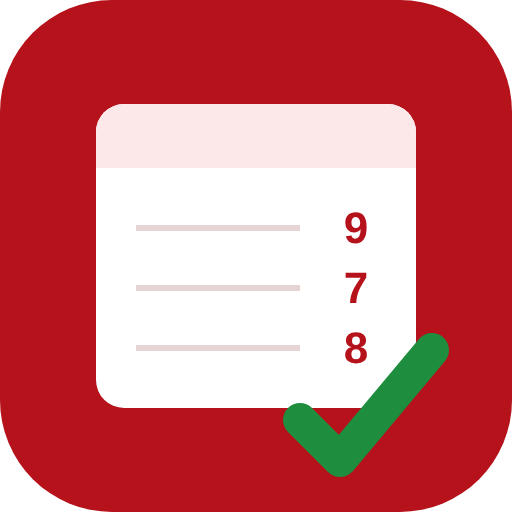

# Educa Navarra · notas con IA

**Pásale tu Excel de notas a Claude y él las mete en Educa por ti.**<br>
También escribe las observaciones para las familias y redacta y registra partes de convivencia. Tú revisas la pantalla y decides cuándo se guarda.

[](https://www.npmjs.com/package/educa-navarra-mcp)
[](https://github.com/vTanco/educa-navarra-mcp/blob/main/LICENSE)
[](https://github.com/vTanco/educa-navarra-mcp/actions/workflows/ci.yml)
[](https://www.npmjs.com/package/educa-navarra-mcp)
[](https://github.com/vTanco/educa-navarra-mcp/releases/latest/download/educa-navarra-mcp.mcpb)


**[Descargar para Claude Desktop](https://github.com/vTanco/educa-navarra-mcp/releases/latest/download/educa-navarra-mcp.mcpb)** ·
[Instalación](#instalación) ·
[Primeros pasos](#primeros-pasos) ·
[Partes de convivencia](#partes-de-convivencia) ·
[Cómo funciona](#cómo-funciona) ·
[Preparar el Excel](https://github.com/vTanco/educa-navarra-mcp/blob/main/docs/BUENAS-PRACTICAS.md) ·
[Qué se ha probado](#qué-se-ha-probado) ·
[Protección de datos](#protección-de-datos) ·
[Preguntas](#preguntas-frecuentes)

</div>

> **Herramienta personal y no oficial.** No tiene ningún vínculo con el Departamento de Educación del Gobierno de Navarra. Los datos del alumnado que el conector lee o muestra pasan por Claude. Antes de usarla, lee [Protección de datos](#protección-de-datos) y el [aviso legal](https://github.com/vTanco/educa-navarra-mcp/blob/main/AVISO-LEGAL.md).

<p align="center">
  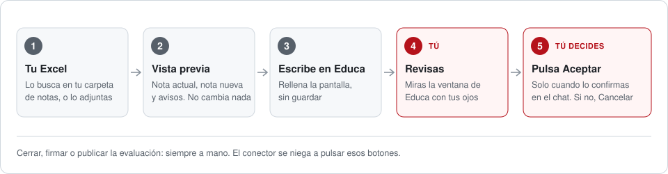
</p>

## Qué hace

| | |
|---|---|
| **Conoce tus grupos** | Lee de Educa tus grupos, agrupamientos, asignaturas y evaluaciones. No hay que escribirlos en ningún ajuste. |
| **Va directo a la pantalla** | *"Abre 1ºCD, 2ª evaluación"* y abre Calificaciones con el grupo, la materia y la evaluación elegidos. Basta con parte del nombre. |
| **Encuentra tu fichero** | Busca el Excel o CSV en tu carpeta de notas por evaluación, grupo y materia. También vale adjuntarlo en el chat. |
| **Cruza los nombres** | Empareja tu lista con la de Educa aunque cambien tildes, mayúsculas o el orden de nombre y apellidos. |
| **Enseña una vista previa** | Nota actual, nota nueva y avisos, antes de tocar nada. |
| **Escribe sin guardar** | Rellena las notas en la ventana de Educa para que las revises. |
| **Añade observaciones** | Si tu fichero tiene una columna *Observaciones*, escribe también el comentario para las familias de cada alumno. |
| **Guarda solo si lo dices** | Pulsa *Aceptar* únicamente cuando lo confirmas en el chat. |
| **Redacta partes** | Le cuentas lo que ha pasado y prepara el informe de convivencia con tono formal, lo clasifica según la normativa de Navarra y lo registra en Educa cuando das el visto bueno. |

Sirve para **ESO** (IN, SU, BI, NT, SB), **Bachillerato** (nota sobre 10) y **FP de Grado Medio y Superior**: lee la escala de cada pantalla en vez de suponerla.

## Instalación

Elige una opción. Las tres instalan lo mismo.

| | Para quién | Qué necesitas |
|---|---|---|
| **A · Claude Desktop** | La mayoría de docentes | Claude Desktop. Doble clic y listo |
| **B · Claude Code** | Si ya usas la terminal | Node.js 20 o superior |
| **C · Otras aplicaciones** | Cursor, VS Code, Windsurf, LM Studio… | Node.js 20 o superior |

### A · Claude Desktop (recomendada)

1. Instala [Claude Desktop](https://claude.ai/download) si no lo tienes.
2. **[Descarga `educa-navarra-mcp.mcpb`](https://github.com/vTanco/educa-navarra-mcp/releases/latest/download/educa-navarra-mcp.mcpb)**.
3. Haz **doble clic** en el fichero. Claude Desktop se abre y pregunta si quieres instalarlo: pulsa **Instalar**.
4. Rellena los ajustes. Todos son opcionales:

   | Ajuste | Para qué |
   |---|---|
   | Usuario y contraseña de Educa | Para que Claude entre solo. Si los dejas vacíos, entras tú en la ventana que se abre. La contraseña se guarda cifrada en tu ordenador. |
   | Grupos en los que no pongo notas | Por ejemplo, si compartes docencia: `ESO 2º D, ESO 2º E`. Podrás consultarlos, pero el conector se negará a escribir en ellos. |
   | Carpeta de notas | Donde guardas tus Excel. Deja la que sale (*Documentos/Notas Educa*) y créala si no existe. |

No hace falta instalar nada más: usa el **Google Chrome** o **Microsoft Edge** que ya tienes. Si no hay ninguno, descarga un navegador la primera vez (un par de minutos).

Si el doble clic no funciona, en Claude Desktop ve a **Ajustes → Extensiones → Instalar extensión…** y elige el fichero. Para actualizar a una versión nueva, descarga el fichero otra vez y repite el doble clic.

### B · Claude Code

```bash
claude mcp add educa -- npx -y educa-navarra-mcp
```

### C · Otras aplicaciones compatibles con MCP

Añade esto a la configuración de servidores MCP de tu aplicación:

```json
{
  "mcpServers": {
    "educa": {
      "command": "npx",
      "args": ["-y", "educa-navarra-mcp"]
    }
  }
}
```

<details>
<summary>Entrar solo en Educa con las opciones B o C</summary>

Crea el fichero `credenciales.json` en la carpeta `.educa-mcp` de tu usuario (Mac: `/Users/tu_usuario/.educa-mcp/`; Windows: `C:\Users\tu_usuario\.educa-mcp\`):

```json
{ "usuario": "tu_usuario_de_educa", "clave": "tu_contraseña" }
```

No compartas ese fichero ni lo subas a ningún sitio. También valen las variables `EDUCA_USER` y `EDUCA_PASSWORD` en el bloque `env` de la configuración. El resto de ajustes, en [CONFIGURACION.md](https://github.com/vTanco/educa-navarra-mcp/blob/main/docs/CONFIGURACION.md).
</details>

## Primeros pasos

Escríbele a Claude con tus palabras. La primera vez:

1. **"Actualiza mis grupos."** Entra en Educa, lee tus grupos y asignaturas y los guarda en tu ordenador. Tarda unos segundos por grupo. Repítelo cuando cambien (curso nuevo, sustitución).
2. **"Mete las notas de la 1ª evaluación de BTO N 1ºA, TIC."** Busca el fichero, abre la pantalla y te enseña la vista previa.
3. **"Vale, escríbelas."** Rellena la pantalla de Educa sin guardar. Mira la ventana del navegador.
4. **"Guarda."** Pulsa *Aceptar*. Si algo no te cuadra, no lo digas: pulsa tú *Cancelar* en la ventana de Educa y no se guarda nada.

El cierre y la firma de la evaluación los sigues haciendo tú a mano, como siempre.

Así queda la conversación, de principio a fin:

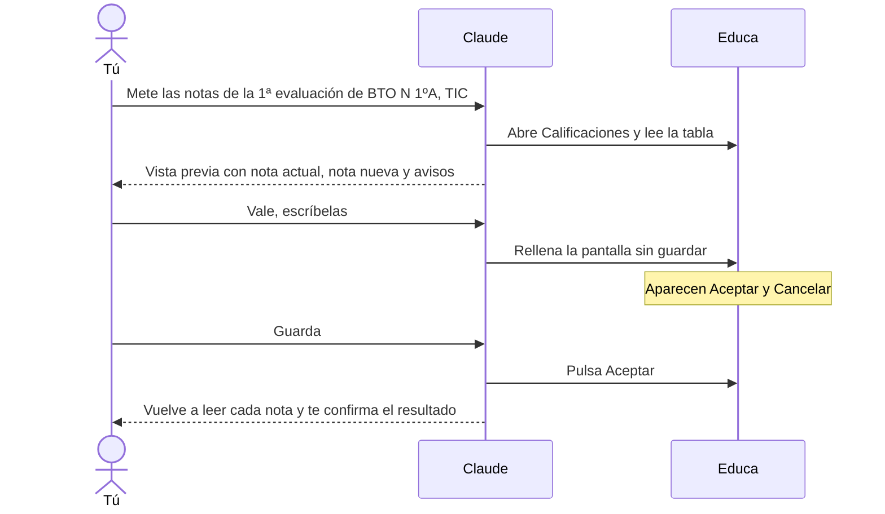

### Qué puedes pedirle

| Quieres… | Dile… |
|---|---|
| Ir directo a un grupo | *"Abre las notas de 1ºAB de Tecnología, 2ª evaluación."* |
| Consultar sin tocar | *"Enséñame las notas de ESO 3ºDEFH, Matemáticas. No cambies nada."* |
| Ver qué ficheros tienes | *"¿Qué ficheros de notas tengo?"* |
| Usar otra columna | *"La nota está en la columna Media T1."* |
| Poner comentarios para las familias | *"Mete también las observaciones de la columna Comentarios."* |
| Aceptar un nombre dudoso | *"Sí, Maite Etxeberria es la misma."* |
| Ver la pantalla | *"Haz una captura de la pantalla."* |
| Aprender a preparar el Excel | *"¿Cómo preparo mi Excel de notas?"* |
| Poner un parte | *"Ponle un parte a Iker Muro, de 3º D: hoy en Tecnología se ha negado a guardar el móvil y me ha contestado de malas maneras."* |

En Claude Desktop tienes además cuatro atajos en el menú **+** del chat: **Meter notas en Educa**, **Revisar mis notas en Educa**, **Cómo preparo mi Excel de notas** y **Poner un parte de convivencia**.

### Nombres de grupo a medias

No hace falta escribir el nombre exacto de Educa. Si lo que dices encaja con un solo grupo, lo abre; si encaja con varios, te pregunta cuál.

| Tus grupos en Educa | Le dices | Abre |
|---|---|---|
| ESO 1ºAB plu, ESO 1ºCD plu, ESO 1ºEF plu | *"1ºCD"* | ESO 1ºCD plu |
| BTO N 1ºA, BTO N 2ºA | *"BTO N 1"* | BTO N 1ºA |
| ESO 1ºAB plu, ESO 1ºCD plu, ESO 1ºEF plu | *"ESO 1"* | Te pregunta cuál de los tres |

Lo mismo con la asignatura (*"Tecnología"*) y la evaluación (*"2"*, *"2a"*, *"Final"*). Si el grupo solo tiene una asignatura, no hace falta decirla.

## Partes de convivencia

<p align="center">
  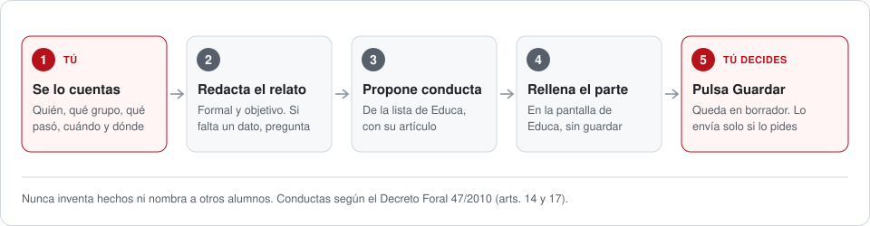
</p>

Cuéntale a Claude, con tus palabras, a quién, de qué grupo, qué ha pasado, cuándo y dónde. Él:

1. **Redacta el relato** de *Observaciones de lo sucedido* con tono formal y objetivo: hechos en orden, en tercera persona, sin juicios ni nombres de otros alumnos. No inventa nada; si falta un dato, te lo pregunta.
2. **Propone el tipo de conducta** entre los que ofrece Educa en tu centro, con su artículo del Decreto Foral 47/2010 (contraria o gravemente perjudicial para la convivencia). Si hay duda, decides tú.
3. **Te enseña el parte completo**: alumno, fecha, espacio y sesión, conducta, contacto con la familia, propuesta de medida y el relato entero. No ha escrito nada todavía.
4. **"Vale, rellénalo."** Abre *Gestión académica → Convivencia → Nuevo informe* y rellena el formulario en pantalla, sin guardar. La sesión la elige sola si ese día solo das una clase a ese alumno; si no, te pregunta la hora.
5. **"Guárdalo."** Pulsa *Guardar* y el informe queda en Educa en borrador, para que lo revises y lo envíes tú. Si le dices *"guárdalo y envíalo"*, pulsa *Guardar y enviar* y te cuenta qué muestra Educa a continuación, sin pulsar nada más.

<p align="center">
  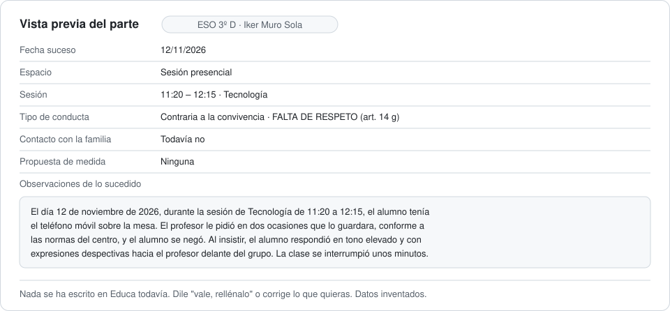
</p>

| Campo de Educa | De dónde sale |
|---|---|
| Fecha suceso | Lo que digas (*hoy*, *ayer* o una fecha) |
| Espacio | *Sesión presencial* por defecto; también recreo, pasillos, comedor… según la lista de Educa |
| Sesión | La que das a ese alumno ese día, o la hora que indiques |
| Observaciones de lo sucedido | El relato que redacta Claude y apruebas tú (máximo 4000 caracteres) |
| Contacto con la familia | Solo si dices que ya has hablado con la familia |
| Tipo de conducta | Lista de Educa; Claude propone y tú confirmas |
| Propuesta de medida | Opcional, de la lista de Educa |

Correspondencia completa entre los rótulos de Educa y los artículos del decreto en [normativa-convivencia.md](https://github.com/vTanco/educa-navarra-mcp/blob/main/docs/normativa-convivencia.md).

## Tu fichero de notas

Vale casi cualquier Excel (`.xlsx`) o CSV con una fila por alumno y una columna de nota. Para que Claude lo encuentre solo:

| | Recomendación | Ejemplo |
|---|---|---|
| **Carpeta** | Una para todo, con subcarpeta por curso | `Documentos/Notas Educa/2026-27/` |
| **Nombre** | `EVALUACIÓN_GRUPO_MATERIA` | `1EV_BTO-1A_TIC.xlsx` |
| **Contenido** | Cabeceras en la primera fila, una fila por alumno | *Apellidos · Nombre · Nota* |

<p align="center">
  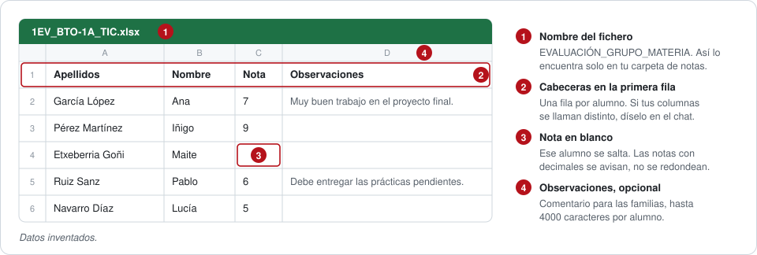
</p>

- Si tus columnas se llaman de otra forma, díselo: *"la nota está en la columna Media T1"*.
- Los alumnos con la nota en blanco se saltan.
- **Observaciones para las familias (opcional).** Añade una columna *Observaciones* con el comentario de cada alumno y Claude lo escribirá en el cuadro de observaciones de Educa (hasta 4000 caracteres). Puedes dejar la nota vacía y poner solo la observación. Si un alumno ya tiene observaciones en Educa, no se sustituyen salvo que lo pidas.
- **No redondea por ti**: si una nota no vale para esa enseñanza, avisa y no la escribe.

Todos los consejos, con ejemplos para interinos que cambian de centro, en la **[guía para preparar los Excel](https://github.com/vTanco/educa-navarra-mcp/blob/main/docs/BUENAS-PRACTICAS.md)**.

### Así es la vista previa

<p align="center">
  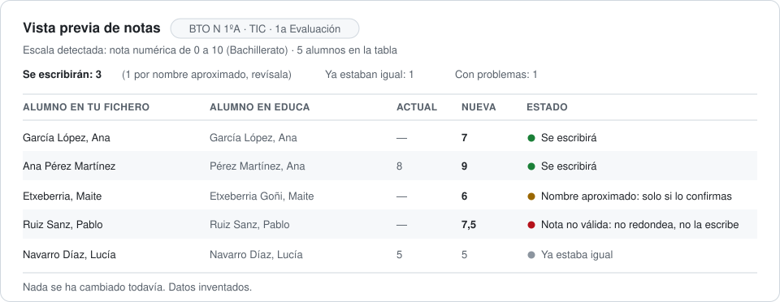
</p>

Si el fichero trae observaciones, la vista previa añade una columna con el texto que se escribirá para cada alumno.

Los nombres que solo coinciden en parte se marcan como *aproximados* y no se escriben salvo que lo confirmes. También avisa de alumnos del fichero que no están en Educa y de alumnos de Educa que no tienen nota en el fichero.

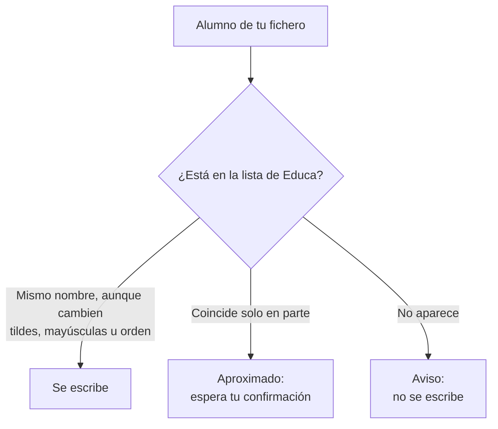

## Cualquier etapa

El conector no supone cómo se califica: lee la pantalla de Educa abierta y se adapta. Vale igual si este curso das ESO y el siguiente un ciclo formativo.

<p align="center">
  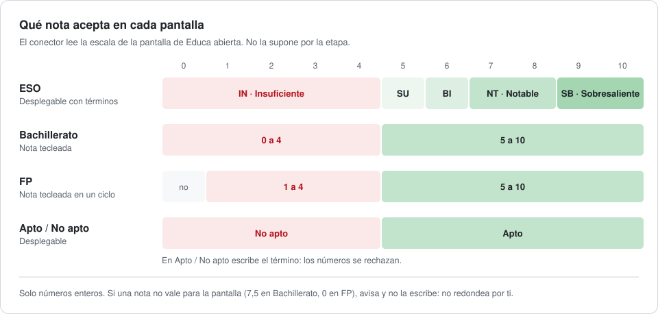
</p>

<details>
<summary>Detalle por tipo de pantalla</summary>

| Lo que ofrece Educa | Qué acepta de tu fichero |
|---|---|
| Desplegable con términos (ESO): IN, SU, BI, NT, SB | El término (*NT*, *Notable*) o un número entero: 0–4 IN · 5 SU · 6 BI · 7–8 NT · 9–10 SB |
| Nota tecleada (Bachillerato) | Entero de 0 a 10 |
| Nota tecleada en un ciclo (FP) | Entero de 1 a 10 |
| Desplegable Apto / No apto | El término; rechaza números |
| Otros valores (FPEX, EX, NP…) | Solo si la pantalla los ofrece |

</details>

La vista previa dice siempre qué escala ha detectado. Normativa de referencia (LOMLOE y órdenes forales de Navarra) en [normativa-evaluacion.md](https://github.com/vTanco/educa-navarra-mcp/blob/main/docs/normativa-evaluacion.md).

## Qué hace solo y qué necesita tu permiso

<p align="center">
  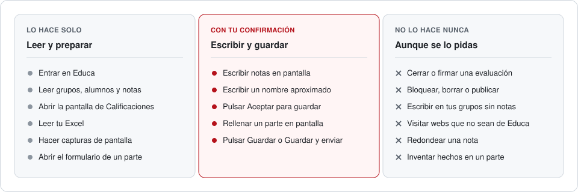
</p>

<details>
<summary>La misma información en una tabla</summary>

| Lo hace solo | Necesita que lo confirmes | No lo hace nunca |
|---|---|---|
| Entrar en Educa | Escribir notas en pantalla (tras la vista previa) | Cerrar o firmar una evaluación |
| Leer grupos, alumnos y notas | Escribir un nombre aproximado | Bloquear, borrar o publicar |
| Abrir la pantalla de Calificaciones | Pulsar *Aceptar* para guardar | Escribir en tus grupos sin notas |
| Leer tu Excel | | Visitar webs que no sean de Educa |
| Hacer capturas de pantalla | Rellenar un parte en pantalla (tras la vista previa) | Redondear una nota |
| Abrir el formulario de un parte y leer sus listas | Pulsar *Guardar* o *Guardar y enviar* en un parte | Inventar hechos en un parte |

</details>

Antes de escribir comprueba que la tabla no ha cambiado (mismo grupo y mismos alumnos) y, después, vuelve a leer cada campo. No toca campos bloqueados, como los de una evaluación ya cerrada.

## Qué se ha probado

Cada cambio pasa pruebas automáticas contra un **Educa simulado** (ESO, Bachillerato, FP y Apto / No apto), con todo el recorrido: entrar, abrir el grupo, vista previa, escribir y guardar. Además, se ha probado en el **Educa real** de un instituto de Navarra con una cuenta de profesor, sin guardar nada:

<p align="center">
  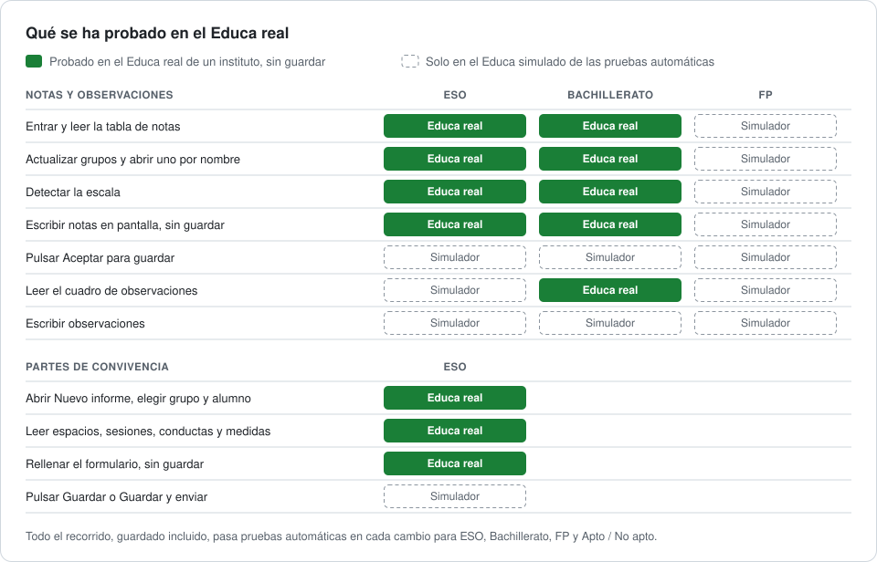
</p>

<details>
<summary>La misma información en tablas</summary>

| | ESO | Bachillerato | FP |
|---|---|---|---|
| Entrar y leer la tabla de notas | Probado en Educa real | Probado en Educa real | Solo simulador |
| Actualizar grupos y abrir un grupo por nombre parcial | Probado en Educa real | Probado en Educa real | Solo simulador |
| Detectar la escala | Probado en Educa real (términos) | Probado en Educa real (0 a 10) | Solo simulador |
| Escribir en pantalla, sin guardar | Probado en Educa real | Probado en Educa real | Solo simulador |
| Pulsar *Aceptar* para guardar | Solo simulador | Solo simulador | Solo simulador |
| Leer el cuadro de observaciones | Solo simulador | Probado en Educa real | Solo simulador |
| Escribir observaciones | Solo simulador | Solo simulador | Solo simulador |

| Partes de convivencia | |
|---|---|
| Abrir *Nuevo informe*, elegir grupo y alumno | Probado en Educa real |
| Leer espacios, sesiones del alumno, conductas y medidas | Probado en Educa real |
| Rellenar el formulario en pantalla, sin guardar | Probado en Educa real (ESO) |
| Pulsar *Guardar* o *Guardar y enviar* | Solo simulador |

</details>

En el Educa real se ha comprobado que, al escribir una nota, Educa muestra *Aceptar* y *Cancelar* y no guarda hasta pulsar uno de los dos; el guardado definitivo se ha dejado para cuando un docente lo haga con sus propias notas. ¿Lo has usado en tu enseñanza? Cuéntalo en [Issues](https://github.com/vTanco/educa-navarra-mcp/issues).

## Cómo funciona

Educa no tiene una conexión oficial para aplicaciones, así que el conector hace lo mismo que harías tú: abre una ventana del navegador en tu ordenador, entra en Educa y rellena la pantalla. Claude le dice qué hacer y tú lo ves todo.

<p align="center">
  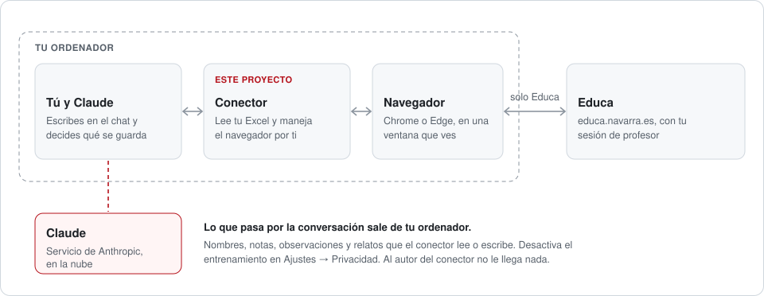
</p>

## Protección de datos

Léelo antes de usar el conector con datos reales.

- **Herramienta personal y no oficial.** La ha hecho un docente por su cuenta. No está desarrollada, respaldada ni supervisada por el Departamento de Educación del Gobierno de Navarra, ni tiene vínculo alguno con él.
- **Los datos pasan por Claude.** Todo lo que el conector lee o muestra (nombres del alumnado, notas, observaciones para las familias, relatos de partes de convivencia) y lo que tú cuentes en el chat se envía a Claude como parte de la conversación, y puede quedar guardado en tu historial de conversaciones.
- **Tú decides si puedes usarla.** Cada docente la usa bajo su propia responsabilidad y conforme a las normas de su centro y a las indicaciones de la persona delegada de protección de datos (DPD) del Departamento de Educación. Si tienes dudas, consúltalo antes.
- **Desactiva el entrenamiento.** En Claude, ve a **Ajustes → Privacidad** y desactiva la opción que permite usar tus conversaciones para mejorar los modelos (*Ayudar a mejorar Claude*).
- **El desarrollador no recibe nada.** No hay servidores propios: el conector se ejecuta en tu ordenador, solo visita Educa (`*.navarra.es`) y no recoge credenciales, datos del alumnado ni estadísticas de uso.
- **Tu contraseña no pasa por el chat.** Se guarda en tu ordenador y solo se escribe en el formulario de acceso de Educa.
- **Comparte lo mínimo.** Usa ficheros con solo las columnas necesarias, no pidas capturas si no hacen falta y, en los partes, cuenta solo los hechos necesarios, sin nombres de otros alumnos.
- **Sin garantía.** Se distribuye con [licencia MIT](https://github.com/vTanco/educa-navarra-mcp/blob/main/LICENSE), tal cual y sin garantía de ningún tipo. Revisa siempre la pantalla de Educa antes de guardar.

Más detalle en el [aviso legal](https://github.com/vTanco/educa-navarra-mcp/blob/main/AVISO-LEGAL.md).

## Preguntas frecuentes

<details>
<summary><b>¿Puede guardar algo sin que yo me entere?</b></summary>

No. Guardar exige una confirmación expresa en el chat, y Claude Desktop te pide permiso antes de usar esa herramienta. Además, nunca pulsa botones de cerrar, firmar, bloquear, borrar o publicar.
</details>

<details>
<summary><b>Entro en Educa con Cl@ve o certificado. ¿Funciona?</b></summary>

Sí. Deja usuario y contraseña vacíos y haz tú ese paso en la ventana que se abre. El conector espera a que termines.
</details>

<details>
<summary><b>Me cambio de centro o de etapa el curso que viene.</b></summary>

Di *"actualiza mis grupos"* al empezar el curso y listo. La escala de notas la detecta en cada pantalla, así que no hay que configurar nada para pasar de ESO a Bachillerato o a FP.
</details>

<details>
<summary><b>No encuentra mi grupo.</b></summary>

Pídele *"actualiza mis grupos"* y vuelve a intentarlo. Si tu nombre encaja con varios grupos, te dirá cuáles y te pedirá el nombre completo.
</details>

<details>
<summary><b>Me dice que no encuentra la tabla de notas.</b></summary>

Educa cambia a veces su diseño. Pide a Claude *"haz una captura de la pantalla"* y abre un aviso en [Issues](https://github.com/vTanco/educa-navarra-mcp/issues) **sin datos de alumnos** (tapa los nombres). Los ajustes avanzados están en [CONFIGURACION.md](https://github.com/vTanco/educa-navarra-mcp/blob/main/docs/CONFIGURACION.md).
</details>

<details>
<summary><b>¿Cómo lo desinstalo?</b></summary>

En Claude Desktop: **Ajustes → Extensiones → Educa Navarra → Desinstalar**. Si quieres borrar también la sesión guardada del navegador y la lista de grupos, elimina la carpeta `.educa-mcp` de tu usuario.
</details>

## Para desarrolladores

```bash
git clone https://github.com/vTanco/educa-navarra-mcp.git
cd educa-navarra-mcp
npm install
npm run build
npm test          # ficheros, conversión de notas y emparejamiento de nombres
npm run smoke     # recorrido completo contra un Educa simulado
npm run pack:mcpb # genera build/educa-navarra-mcp.mcpb para Claude Desktop
```

| Documento | Contenido |
|---|---|
| [CONFIGURACION.md](https://github.com/vTanco/educa-navarra-mcp/blob/main/docs/CONFIGURACION.md) | Herramientas, variables de entorno, fichero de configuración y Educa simulado |
| [BUENAS-PRACTICAS.md](https://github.com/vTanco/educa-navarra-mcp/blob/main/docs/BUENAS-PRACTICAS.md) | Guía para docentes sobre cómo preparar los Excel |
| [normativa-evaluacion.md](https://github.com/vTanco/educa-navarra-mcp/blob/main/docs/normativa-evaluacion.md) | Resumen de la normativa de evaluación por etapa |
| [PUBLICAR.md](https://github.com/vTanco/educa-navarra-mcp/blob/main/docs/PUBLICAR.md) | Cómo sacar una versión (GitHub y npm) |
| [CHANGELOG.md](https://github.com/vTanco/educa-navarra-mcp/blob/main/CHANGELOG.md) | Cambios de cada versión |

---

<sub>Licencia [MIT](https://github.com/vTanco/educa-navarra-mcp/blob/main/LICENSE). Proyecto personal, independiente y sin ánimo de lucro, sin relación con el Departamento de Educación del Gobierno de Navarra. "Educa" es el nombre del portal educativo del Gobierno de Navarra y se usa solo para describir con qué funciona esta herramienta.</sub>
